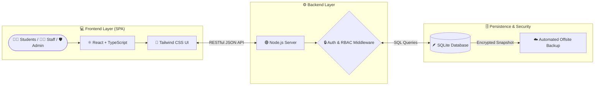

<div align="center">

  

  # 🎓 CampusOS
  ### **Next-Generation School & Campus Management Platform**

  <p align="center">
    A full-stack, production-ready educational management system built with <b>React</b>, <b>TypeScript</b>, <b>Tailwind CSS</b>, <b>Node.js</b>, and <b>SQLite</b>—engineered for speed, data security, and seamless institutional operations.
    <br />
    <br />
    <a href="#-quick-start"><strong>🚀 Quick Start</strong></a> ·
    <a href="#-system-architecture"><strong>🏗️ Architecture</strong></a> ·
    <a href="#-core-modules--roles"><strong>🧩 Modules</strong></a> ·
    <a href="https://github.com/Adamnazeri/campusos/issues"><strong>🐞 Report Issue</strong></a>
  </p>

  <!-- TECH STACK BADGES -->
  [](https://react.dev/)
  [](https://www.typescriptlang.org/)
  [](https://vitejs.dev/)
  [](https://tailwindcss.com/)
  [](https://nodejs.org/)
  [](https://www.sqlite.org/)
  [](https://www.docker.com/)

</div>

<br />

---

## 🌟 Why CampusOS?

<table>
  <tr>
    <td width="50%">
      <h3>⚡ Blazing-Fast SPA Experience</h3>
      <p>Powered by <b>React</b>, <b>Vite</b>, and <b>TypeScript</b>, delivering instant page transitions, strict type safety, and a responsive UI styled with <b>Tailwind CSS</b>.</p>
    </td>
    <td width="50%">
      <h3>🗄️ Zero-Overhead Local Database</h3>
      <p>Utilizes an embedded <b>SQLite</b> relational engine paired with a <b>Node.js</b> REST API—eliminating complex external database servers while maintaining ACID compliance.</p>
    </td>
  </tr>
  <tr>
    <td width="50%">
      <h3>🔐 Enterprise-Grade Data Security</h3>
      <p>Features role-based access control (RBAC), encrypted sensitive credentials, and automated offsite backup routines to protect institutional records.</p>
    </td>
    <td width="50%">
      <h3>🐳 One-Command Client Deployment</h3>
      <p>Fully containerized with <b>Docker</b> so schools, colleges, or administrators can spin up the entire stack consistently across any environment.</p>
    </td>
  </tr>
</table>

---

## 🏗️ System Architecture

GitHub automatically renders the full-stack architecture diagram below, illustrating how requests flow from client devices to the database and backup storage:



---

## 🧩 Core Modules & Roles

| Module | Key Capabilities | Access Level | Status |
| :--- | :--- | :---: | :---: |
| **📊 Executive Dashboard** | Real-time KPIs, attendance statistics, active announcements, and system health. | `Admin` `Staff` | ✅ Active |
| **👨‍🎓 Student Registry** | Student onboarding, demographic profiles, academic history, and status tracking. | `Admin` `Teacher` | ✅ Active |
| **👩‍🏫 Faculty & HR** | Staff directory, role assignments, department mapping, and workload overview. | `Admin` | ✅ Active |
| **📅 Timetable & Classes** | Classroom allocation, subject scheduling, and semester calendar management. | `All Roles` | ✅ Active |
| **🛡️ Security & Backups** | Key management, database snapshot triggers, and audit logs. | `System Admin` | ✅ Active |

---

## 🛠️ Technology Stack Breakdown

| Layer | Technology | Purpose |
| :--- | :---: | :--- |
| **Frontend UI** |   | Component-driven user interface & utility-first responsive design |
| **Language & Build** |   | Static type checking & lightning-fast HMR bundling |
| **Backend Runtime** |  | REST API endpoints, authentication, and business logic |
| **Database Engine** |  | Lightweight, file-based relational data persistence |
| **Infrastructure** |   | Containerized deployment & large asset version tracking |

---

## 🚀 Quick Start

> [!IMPORTANT]
> Ensure you have **Node.js (v18+)** and **Git** installed on your machine before proceeding.

### 1️⃣ Clone the Repository
```bash
git clone [https://github.com/Adamnazeri/campusos.git](https://github.com/Adamnazeri/campusos.git)
cd campusos
```

### 2️⃣ Install Dependencies & Run

<details open>
<summary><b>💻 Standard Local Development (Node.js / Vite)</b></summary>
<br />

```bash
# Pull large assets tracked via Git LFS (if applicable)
git lfs pull

# Install project dependencies
npm install

# Start the development server
npm run dev
```
Once started, open **`http://localhost:5173`** in your browser.
</details>

<details>
<summary><b>🐳 Production Deployment (Docker Container)</b></summary>
<br />

```bash
# Build and start containers in the background
docker-compose up -d --build

# View real-time server logs
docker-compose logs -f
```
</details>

> [!TIP]
> **Environment Configuration:** Copy `.env.example` to `.env` (or create a `.env` file in the root directory) to customize your server port, database file path, and encryption secret keys before launching in production.

---

## 📜 Available Scripts

| Command | Action | Description |
| :--- | :--- | :--- |
| `npm run dev` | **Development** | Starts the Vite dev server with Hot Module Replacement (HMR) |
| `npm run build` | **Production Build** | Compiles TypeScript and bundles optimized static assets into `dist/` |
| `npm run preview` | **Preview Build** | Locally previews the compiled production build before deployment |
| `npm run lint` | **Code Quality** | Runs ESLint to catch syntax and formatting issues |

---

## 📂 Project Structure

```text
campusos/
├── 📁 src/                     # Frontend application source code
│   ├── 📁 components/          # Reusable UI components (buttons, modals, tables)
│   ├── 📁 pages/               # Route views (Dashboard, Students, Staff, Settings)
│   ├── 📁 services/            # API client handlers & data fetching logic
│   ├── 📄 App.tsx              # Main application router and layout shell
│   └── 📄 main.tsx             # React DOM entry point
├── 📁 server/                  # Backend Node.js API & SQLite database handlers
├── 📁 public/                  # Static assets, icons, and school branding
├── 📄 package.json             # Dependencies and npm scripts
├── 📄 tsconfig.json            # TypeScript compiler configuration
├── 📄 vite.config.ts           # Vite bundler configuration
└── 📄 README.md                # Project documentation
```

---

## 🔧 Troubleshooting & FAQ

<details>
<summary><b>❓ Port 5173 is already in use</b></summary>
<br />
Vite will automatically increment to the next available port (e.g., <code>5174</code>), or you can specify a custom port manually:
<pre><code>npx vite --port 3000</code></pre>
</details>

<details>
<summary><b>❓ SQLite database locked or missing tables on first run</b></summary>
<br />
Ensure the backend process has write permissions to the database directory and that no duplicate Node.js instances are accessing the same <code>.sqlite</code> / <code>.db</code> file simultaneously.
</details>

---

<div align="center">

## 👨‍💻 Developed By

**Adam Nazeri**  
[](https://github.com/Adamnazeri)

*Built with ❤️ to modernize campus administration. Star ⭐ this repo if you find it useful!*

</div>
