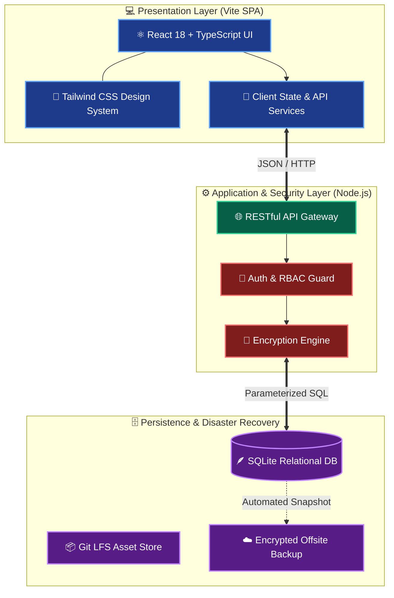
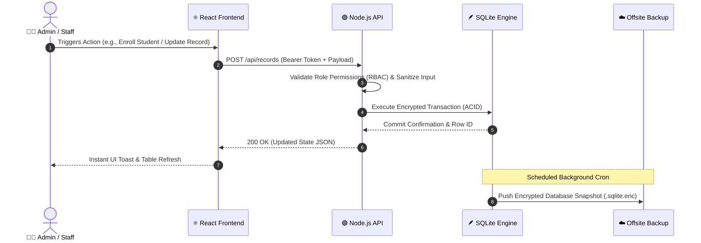

<div align="center">

<!-- ANIMATED HEADER BANNER -->


<!-- ANIMATED TYPING SUBTITLE -->
<a href="https://github.com/Adamnazeri/campusos">
  
</a>

<br />

<!-- DYNAMIC GITHUB REPO BADGES -->


<br />

<!-- MODERN SKILL ICONS SHOWCASE -->
<a href="https://skillicons.dev">
  
</a>

<br /><br />

<!-- NAVIGATION PILLS -->
<kbd> <a href="#-executive-overview">📖 Overview</a> </kbd>
<kbd> <a href="#-system-architecture">🏗️ Architecture</a> </kbd>
<kbd> <a href="#-rbac-permission-matrix">🛡️ RBAC Matrix</a> </kbd>
<kbd> <a href="#-quick-start--deployment">🚀 Quick Start</a> </kbd>
<kbd> <a href="#-api--database-specs">📡 API & DB</a> </kbd>
<kbd> <a href="#-project-roadmap">🗺️ Roadmap</a> </kbd>

</div>

<br />

---

## 📖 Executive Overview

**CampusOS** is a modern, self-contained educational ERP and campus management platform engineered for high reliability, instant responsiveness, and strict data sovereignty. Designed to eliminate bloated legacy software, it pairs a lightning-fast **React + TypeScript (Vite)** frontend with a resilient **Node.js + SQLite** backend—complete with cryptographic data protection, role-based access control, and one-click **Docker** deployment.

<table>
  <tr>
    <td width="50%" valign="top">
      <h3>⚡ Next-Gen Frontend Engineering</h3>
      <ul>
        <li><b>Strict Type Safety:</b> End-to-end TypeScript interfaces prevent runtime data mismatches.</li>
        <li><b>Instant HMR & Bundling:</b> Powered by Vite for sub-second builds and zero-lag navigation.</li>
        <li><b>Adaptive UI System:</b> Crafted with Tailwind CSS for seamless desktop, tablet, and mobile responsiveness.</li>
      </ul>
    </td>
    <td width="50%" valign="top">
      <h3>🛡️ Resilient Backend & Storage</h3>
      <ul>
        <li><b>Embedded ACID Database:</b> SQLite relational storage delivers high-speed local queries with zero external DB server overhead.</li>
        <li><b>Cryptographic Security:</b> Sensitive institutional records are protected via environment-bound encryption keys.</li>
        <li><b>Disaster Recovery:</b> Automated snapshot pipelines support secure offsite backups.</li>
      </ul>
    </td>
  </tr>
</table>

---

## 🏗️ System Architecture

### 1. High-Level Infrastructure Topology
GitHub natively renders the color-coded topology below, illustrating how client requests traverse the application layers:



### 2. Request & Data Lifecycle (Sequence Flow)



---

## 🛡️ RBAC Permission Matrix

**CampusOS** enforces strict Role-Based Access Control across all core modules to protect institutional integrity:

| System Module | 🛡️ Super Admin | 👩‍💼 Office Staff | 👨‍🏫 Faculty / Teacher | 👨‍🎓 Student / Parent | Module Readiness |
| :--- | :---: | :---: | :---: | :---: | :---: |
| **📊 Executive Analytics Dashboard** | ✅ Full Access | ✅ View & Export | 👀 View Assigned | ❌ Restricted |  |
| **👨‍🎓 Student Enrollment & Profiles** | ✅ CRUD + Archive | ✅ Create & Edit | 👀 View Roster | 👀 Own Profile |  |
| **👩‍🏫 Staff & HR Directory** | ✅ Full Access | 👀 View Directory | 👀 Department Only | ❌ Restricted |  |
| **📅 Timetable & Room Allocation** | ✅ Full Override | ✅ Manage Schedules | ✅ View & Request | 👀 View Schedule |  |
| **📝 Attendance & Grading Ledger** | ✅ Audit & Unlock | 👀 Generate Reports | ✅ Mark & Grade | 👀 View Summary |  |
| **🔐 Encryption & Offsite Backups** | ✅ Full Control | ❌ Restricted | ❌ Restricted | ❌ Restricted |  |

---

## 🛠️ Technology Stack Specification

| Domain | Technology | Version | Architectural Role |
| :--- | :--- | :---: | :--- |
| **Frontend Core** |  | `18.x` | Component-based declarative UI rendering |
| **Type System** |  | `5.x` | Compile-time type checking and contract enforcement |
| **Build Tooling** |  | `5.x` | ESBuild-powered bundler and instant HMR dev server |
| **Styling Engine** |  | `3.x` | Utility-first CSS framework for consistent design tokens |
| **Backend Server** |  | `18+ LTS` | Asynchronous REST API, business logic, and file I/O |
| **Database** |  | `3.x` | Embedded, zero-latency relational SQL engine |
| **Containerization** |  | `24+` | Reproducible client packaging and isolated deployment |

---

## 🚀 Quick Start & Deployment

> [!IMPORTANT]
> **Prerequisites:** Ensure **Node.js (`>= 18.x`)**, **Git**, and **Git LFS** are installed on your host machine before cloning.

### ⚡ Step 1: Clone & Initialize
```bash
# Clone both repositories (Main or v1.0 Release)
git clone [https://github.com/Adamnazeri/campusos.git](https://github.com/Adamnazeri/campusos.git)
cd campusos

# Pull any binary/media assets tracked by Git LFS
git lfs pull
```

### ⚙️ Step 2: Environment Variables Setup
Create a `.env` file in the root directory before launching the server:

<details open>
<summary><b>🔑 Click to view <code>.env</code> Configuration Template</b></summary>
<br />

```ini
# ==========================================
# CAMPUSOS ENVIRONMENT CONFIGURATION
# ==========================================
NODE_ENV=development
PORT=5173
API_PORT=3001

# Database & Storage
DB_PATH=./server/data/campusos.sqlite

# Security & Cryptography (Generate strong 256-bit keys in production)
ENCRYPTION_KEY=your_32_byte_hex_encryption_key_here
JWT_SECRET=your_super_secret_jwt_signing_key_here

# Offsite Backup Configuration
BACKUP_ENABLED=true
BACKUP_INTERVAL_CRON=0 2 * * *
```
</details>

### 🖥️ Step 3: Choose Your Launch Mode

<details open>
<summary><b>💻 Option A: Local Development Mode (Hot-Reload)</b></summary>
<br />

```bash
# 1. Install all dependencies
npm install

# 2. Start Vite + Node development server
npm run dev
```
> 🌐 **Access App:** Open your browser and navigate to **`http://localhost:5173`**
</details>

<details>
<summary><b>🐳 Option B: Production Docker Deployment (Recommended for Clients)</b></summary>
<br />

```bash
# 1. Build and spin up isolated containers in detached mode
docker-compose up -d --build

# 2. Verify container health and live logs
docker-compose ps
docker-compose logs -f
```
</details>

<details>
<summary><b>📦 Option C: Standalone Production Build</b></summary>
<br />

```bash
# Compile TypeScript and minify static assets into /dist
npm run build

# Preview production bundle locally
npm run preview
```
</details>

---

## 📡 API & Database Specs

<details>
<summary><b>🔌 Core REST API Endpoints Overview (Click to Expand)</b></summary>
<br />

| Method | Endpoint | Auth Required | Description |
| :---: | :--- | :---: | :--- |
| `POST` | `/api/auth/login` | ❌ Public | Authenticates user credentials and issues session token |
| `GET` | `/api/dashboard/stats` | ✅ Bearer | Retrieves aggregated campus KPIs and attendance metrics |
| `GET` | `/api/students` | ✅ Bearer | Lists paginated student records with search & filter query params |
| `POST` | `/api/students` | ✅ Admin/Staff | Registers a new student record into SQLite |
| `PUT` | `/api/students/:id` | ✅ Admin/Staff | Updates existing student profile or academic status |
| `POST` | `/api/system/backup` | ✅ Super Admin | Triggers an immediate encrypted SQLite snapshot |

</details>

<details>
<summary><b>📂 Complete Repository Directory Tree (Click to Expand)</b></summary>
<br />

```text
campusos/
├── 📁 public/                  # Static branding assets, favicons & manifest
├── 📁 server/                  # Node.js backend service
│   ├── 📁 controllers/         # Request handlers & business logic
│   ├── 📁 data/                # SQLite database file & encrypted snapshots
│   ├── 📁 middleware/          # Auth, RBAC & payload encryption guards
│   └── 📄 index.ts             # Backend entry point
├── 📁 src/                     # React + TypeScript frontend source
│   ├── 📁 assets/              # UI illustrations & media (Git LFS tracked)
│   ├── 📁 components/          # Reusable UI primitives (Tables, Modals, Cards)
│   ├── 📁 context/             # Global Auth & Theme state providers
│   ├── 📁 pages/               # Route-level views (Dashboard, Students, Settings)
│   ├── 📁 services/            # Axios/Fetch API wrappers
│   ├── 📁 types/               # Shared TypeScript interfaces & schemas
│   ├── 📄 App.tsx              # Application router & shell layout
│   └── 📄 main.tsx             # React DOM mount point
├── 📄 .env.example             # Sample environment variables template
├── 📄 .gitattributes           # Git LFS tracking rules
├── 📄 docker-compose.yml       # Multi-container orchestration config
├── 📄 Dockerfile               # Production container build instructions
├── 📄 package.json             # Dependencies & scripts manifest
├── 📄 tailwind.config.js       # Custom design tokens & utility config
├── 📄 tsconfig.json            # Strict TypeScript compiler rules
├── 📄 vite.config.ts           # Vite bundler & proxy configuration
└── 📄 README.md                # Documentation hub
```
</details>

---

## 🗺️ Project Roadmap

- [x] **Phase 1:** Core SPA Architecture with React, TypeScript & Tailwind CSS
- [x] **Phase 2:** Embedded SQLite Database & Node.js REST API Integration
- [x] **Phase 3:** Role-Based Access Control (RBAC) & Encrypted Data Storage
- [x] **Phase 4:** Docker Containerization & Automated Offsite Backup Pipeline
- [ ] **Phase 5:** Real-time Parent/Student Notification Portal (WebSockets / Push)
- [ ] **Phase 6:** AI-Assisted Timetable Conflict Resolver & Attendance Analytics

---

## 🛡️ Security Policy & Best Practices

> [!WARNING]
> **Never commit `.env` files, raw `.sqlite` production databases, or private encryption keys to version control.** Always verify `.gitignore` rules before pushing client updates.

* **Key Rotation:** Rotate `ENCRYPTION_KEY` and `JWT_SECRET` periodically using the built-in re-encryption utility.
* **Backup Verification:** Test restoring offsite `.sqlite` snapshots in a staging container quarterly to guarantee zero data loss (RPO/RTO compliance).

---

<div align="center">

## 👨‍💻 Author & Maintainer


### **Adam Nazeri**
*Software Developer & System Integrator*

[](https://github.com/Adamnazeri)
[](https://github.com/Adamnazeri/campusos)

<br />

**⭐ If CampusOS inspires your workflow or helps your institution, give this repository a Star! ⭐**

<!-- ANIMATED FOOTER WAVE -->


</div>
