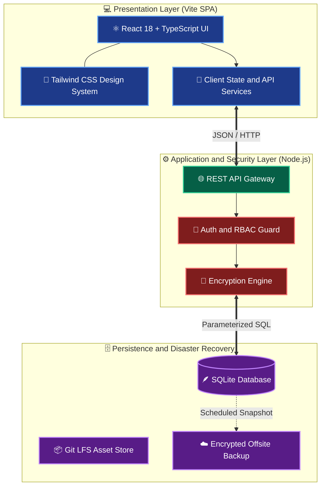
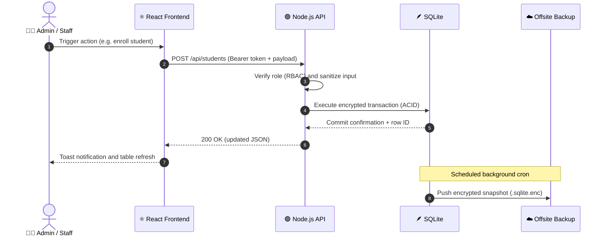

<div align="center">

<!-- ANIMATED HEADER BANNER -->


<!-- ANIMATED TYPING SUBTITLE -->
<a href="https://github.com/Adamnazeri/campusos">
  
</a>

<br /><br />

<!-- BADGES -->


<br /><br />

<!-- TECH ICONS -->
<a href="https://skillicons.dev">
  
</a>

<br /><br />

<!-- NAVIGATION -->
<kbd> <a href="#overview">📖 Overview</a> </kbd>
<kbd> <a href="#features">✨ Features</a> </kbd>
<kbd> <a href="#architecture">🏗️ Architecture</a> </kbd>
<kbd> <a href="#rbac">🛡️ RBAC</a> </kbd>
<kbd> <a href="#quickstart">🚀 Quick Start</a> </kbd>
<kbd> <a href="#api">📡 API</a> </kbd>
<kbd> <a href="#roadmap">🗺️ Roadmap</a> </kbd>

</div>

<br />

---

<a id="overview"></a>
## 📖 Executive Overview

**CampusOS** is a modern, self-contained school ERP and campus management platform built for reliability, speed, and full data ownership. It replaces bloated legacy software with a fast **React + TypeScript (Vite)** frontend and a lightweight **Node.js + SQLite** backend, complete with encryption, role-based access control, and one-command **Docker** deployment.

<table>
  <tr>
    <td width="50%" valign="top">
      <h3>⚡ Modern Frontend</h3>
      <ul>
        <li><b>Strict Type Safety:</b> End-to-end TypeScript interfaces catch data mismatches before runtime.</li>
        <li><b>Instant HMR &amp; Builds:</b> Vite delivers near-instant dev feedback and fast production bundles.</li>
        <li><b>Responsive by Design:</b> Tailwind CSS adapts cleanly to desktop, tablet, and mobile.</li>
      </ul>
    </td>
    <td width="50%" valign="top">
      <h3>🛡️ Resilient Backend</h3>
      <ul>
        <li><b>Embedded ACID Database:</b> SQLite gives fast local queries with no external DB server to manage.</li>
        <li><b>Encrypted Records:</b> Sensitive data is protected with environment-bound encryption keys.</li>
        <li><b>Disaster Recovery:</b> Scheduled snapshots support secure offsite backups.</li>
      </ul>
    </td>
  </tr>
</table>

---

<a id="features"></a>
## ✨ Features at a Glance

| | | |
| :---: | :---: | :---: |
| 📊 **Analytics Dashboard**<br/>Live campus KPIs &amp; attendance metrics | 👨‍🎓 **Student Management**<br/>Enrollment, profiles &amp; archiving | 👩‍🏫 **Staff &amp; HR Directory**<br/>Department-aware staff records |
| 📅 **Timetable &amp; Rooms**<br/>Schedules and room allocation | 📝 **Attendance &amp; Grading**<br/>Mark, grade, audit &amp; unlock | 🔐 **Encryption &amp; Backups**<br/>Encrypted snapshots, one-click trigger |
| 🛡️ **Granular RBAC**<br/>Four roles, strict permissions | 🐳 **Docker Ready**<br/>`docker compose up` and go | 📱 **Fully Responsive**<br/>Works on any screen size |

---

<a id="architecture"></a>
## 🏗️ System Architecture

### 1. High-Level Topology



### 2. Request &amp; Data Lifecycle



---

<a id="rbac"></a>
## 🛡️ RBAC Permission Matrix

CampusOS enforces strict Role-Based Access Control across every core module:

| System Module | 🛡️ Super Admin | 👩‍💼 Office Staff | 👨‍🏫 Faculty | 👨‍🎓 Student / Parent | Readiness |
| :--- | :---: | :---: | :---: | :---: | :---: |
| **📊 Analytics Dashboard** | ✅ Full Access | ✅ View &amp; Export | 👀 View Assigned | ❌ Restricted |  |
| **👨‍🎓 Student Enrollment &amp; Profiles** | ✅ CRUD + Archive | ✅ Create &amp; Edit | 👀 View Roster | 👀 Own Profile |  |
| **👩‍🏫 Staff &amp; HR Directory** | ✅ Full Access | 👀 View Directory | 👀 Department Only | ❌ Restricted |  |
| **📅 Timetable &amp; Room Allocation** | ✅ Full Override | ✅ Manage Schedules | ✅ View &amp; Request | 👀 View Schedule |  |
| **📝 Attendance &amp; Grading** | ✅ Audit &amp; Unlock | 👀 Generate Reports | ✅ Mark &amp; Grade | 👀 View Summary |  |
| **🔐 Encryption &amp; Offsite Backups** | ✅ Full Control | ❌ Restricted | ❌ Restricted | ❌ Restricted |  |

> **Legend:** ✅ can act •  👀 read-only  •  ❌ no access

---

## 🛠️ Technology Stack

| Domain | Technology | Version | Role |
| :--- | :--- | :---: | :--- |
| **Frontend** |  | `18.x` | Component-based declarative UI |
| **Language** |  | `5.x` | Static typing &amp; contract enforcement |
| **Build Tool** |  | `5.x` | Fast bundler &amp; HMR dev server |
| **Styling** |  | `3.x` | Utility-first design tokens |
| **Backend** |  | `18+ LTS` | REST API, business logic, file I/O |
| **Database** |  | `3.x` | Embedded relational SQL engine |
| **Container** |  | `24+` | Reproducible, isolated deployment |

---

<a id="quickstart"></a>
## 🚀 Quick Start &amp; Deployment

> [!IMPORTANT]
> **Prerequisites:** **Node.js `>= 18`**, **Git**, and **Git LFS** must be installed before cloning.

### ⚡ Step 1: Clone &amp; Initialize

```bash
# Clone the repository
git clone https://github.com/Adamnazeri/campusos.git
cd campusos

# Pull binary/media assets tracked by Git LFS
git lfs install
git lfs pull
```

### ⚙️ Step 2: Configure Environment

Copy the sample file, then edit the values:

```bash
cp .env.example .env
```

<details open="open">
<summary><b>🔑 <code>.env</code> configuration template</b></summary>
<br />

```ini
# ==========================================
# CAMPUSOS ENVIRONMENT CONFIGURATION
# ==========================================
NODE_ENV=development
PORT=5173
API_PORT=3001

# Database and Storage
DB_PATH=./server/data/campusos.sqlite

# Security and Cryptography (use strong 256-bit keys in production)
ENCRYPTION_KEY=your_32_byte_hex_encryption_key_here
JWT_SECRET=your_super_secret_jwt_signing_key_here

# Offsite Backup
BACKUP_ENABLED=true
BACKUP_INTERVAL_CRON=0 2 * * *
```

> 💡 **Generate secure keys:**
> ```bash
> node -e "console.log(require('crypto').randomBytes(32).toString('hex'))"
> ```

</details>

### 🖥️ Step 3: Choose Your Launch Mode

<details open="open">
<summary><b>💻 Option A: Local Development (Hot Reload)</b></summary>
<br />

```bash
npm install
npm run dev
```

🌐 Open **http://localhost:5173**

</details>

<details>
<summary><b>🐳 Option B: Docker Deployment (Recommended for Production)</b></summary>
<br />

```bash
# Build and start containers in the background
docker compose up -d --build

# Check health and follow logs
docker compose ps
docker compose logs -f
```

</details>

<details>
<summary><b>📦 Option C: Standalone Production Build</b></summary>
<br />

```bash
# Type-check and bundle static assets into /dist
npm run build

# Preview the production bundle locally
npm run preview
```

</details>

---

<a id="api"></a>
## 📡 API &amp; Database Specs

<details>
<summary><b>🔌 Core REST API Endpoints</b></summary>
<br />

| Method | Endpoint | Auth | Description |
| :---: | :--- | :---: | :--- |
| `POST` | `/api/auth/login` | 🌍 Public | Authenticate credentials and issue a session token |
| `GET` | `/api/dashboard/stats` | 🔑 Bearer | Aggregated campus KPIs and attendance metrics |
| `GET` | `/api/students` | 🔑 Bearer | Paginated student list with search &amp; filters |
| `POST` | `/api/students` | 🛡️ Admin / Staff | Register a new student record |
| `PUT` | `/api/students/:id` | 🛡️ Admin / Staff | Update a student profile or academic status |
| `POST` | `/api/system/backup` | 👑 Super Admin | Trigger an immediate encrypted snapshot |

</details>

<details>
<summary><b>📂 Repository Structure</b></summary>
<br />

```text
campusos/
├── 📁 public/              # Static assets, favicons and manifest
├── 📁 server/              # Node.js backend
│   ├── 📁 controllers/     # Request handlers and business logic
│   ├── 📁 data/            # SQLite database and encrypted snapshots
│   ├── 📁 middleware/      # Auth, RBAC and encryption guards
│   └── 📄 index.ts         # Backend entry point
├── 📁 src/                 # React + TypeScript frontend
│   ├── 📁 assets/          # Illustrations and media (Git LFS)
│   ├── 📁 components/      # Reusable UI (Tables, Modals, Cards)
│   ├── 📁 context/         # Auth and Theme providers
│   ├── 📁 pages/           # Route views (Dashboard, Students, Settings)
│   ├── 📁 services/        # API wrappers
│   ├── 📁 types/           # Shared TypeScript interfaces
│   ├── 📄 App.tsx          # Router and shell layout
│   └── 📄 main.tsx         # React DOM entry
├── 📄 .env.example         # Environment template
├── 📄 .gitattributes       # Git LFS rules
├── 📄 docker-compose.yml   # Container orchestration
├── 📄 Dockerfile           # Production image build
├── 📄 package.json         # Dependencies and scripts
├── 📄 tailwind.config.js   # Design tokens
├── 📄 tsconfig.json        # TypeScript config
├── 📄 vite.config.ts       # Vite and proxy config
└── 📄 README.md
```

</details>

---

<a id="roadmap"></a>
## 🗺️ Project Roadmap

- [x] **Phase 1:** Core SPA with React, TypeScript &amp; Tailwind CSS
- [x] **Phase 2:** Embedded SQLite &amp; Node.js REST API
- [x] **Phase 3:** Role-Based Access Control &amp; encrypted storage
- [x] **Phase 4:** Docker containerization &amp; automated offsite backups
- [ ] **Phase 5:** Real-time parent/student notification portal (WebSockets / Push)
- [ ] **Phase 6:** AI-assisted timetable conflict resolver &amp; attendance analytics

---

## 🔒 Security Policy &amp; Best Practices

> [!WARNING]
> **Never commit `.env` files, production `.sqlite` databases, or private encryption keys.** Double-check your `.gitignore` before every push.

- 🔄 **Key Rotation:** Rotate `ENCRYPTION_KEY` and `JWT_SECRET` periodically.
- ♻️ **Backup Verification:** Restore offsite snapshots in a staging container every quarter to confirm zero data loss.
- 🔑 **Least Privilege:** Assign users the lowest role that lets them do their job.

---

## 🤝 Contributing

Contributions, issues, and feature requests are welcome!

1. Fork the repository
2. Create a branch: `git checkout -b feature/amazing-feature`
3. Commit your changes: `git commit -m "feat: add amazing feature"`
4. Push: `git push origin feature/amazing-feature`
5. Open a Pull Request

---

<div align="center">

## 👨‍💻 Author &amp; Maintainer

<a href="https://github.com/Adamnazeri">
  
</a>

### **Adam Nazeri**
*Software Developer &amp; System Integrator*

<a href="https://github.com/Adamnazeri"></a>
<a href="https://github.com/Adamnazeri/campusos"></a>

<br /><br />

**⭐ If CampusOS helps your institution or inspires your workflow, give it a star! ⭐**

<!-- ANIMATED FOOTER -->


</div>
